# GrandStay Hotel Booking System — Entity Relationship Diagram

This ER diagram is based on the PostgreSQL schema in SRS §5.2.

```mermaid
erDiagram
    HOTEL_SETTINGS {
        SMALLINT id PK
        VARCHAR name
        VARCHAR address
        VARCHAR phone
        VARCHAR email
    }

    ROOM_CATEGORIES {
        SMALLSERIAL id PK
        VARCHAR name UK
        NUMERIC nightly_price
        SMALLINT capacity
    }

    ROOMS {
        SERIAL id PK
        VARCHAR number UK
        SMALLINT category_id FK
        SMALLINT floor
        room_status status
    }

    USERS {
        BIGSERIAL id PK
        VARCHAR full_name
        VARCHAR email UK
        CHAR mobile
        user_role role
        BOOLEAN is_active
    }

    BOOKINGS {
        BIGSERIAL id PK
        CHAR reference UK
        BIGINT customer_id FK
        INTEGER room_id FK
        DATE check_in
        DATE check_out
        DATERANGE stay
        SMALLINT nights
        SMALLINT guests
        NUMERIC nightly_price
        NUMERIC total_amount
        booking_status status
        BIGINT checked_in_by FK
        BIGINT checked_out_by FK
    }

    PAYMENTS {
        BIGSERIAL id PK
        BIGINT booking_id FK, UK
        NUMERIC amount
        VARCHAR method
        VARCHAR status
    }

    REFUNDS {
        BIGSERIAL id PK
        BIGINT booking_id FK, UK
        NUMERIC amount
        VARCHAR reason
    }

    INVOICES {
        BIGSERIAL id PK
        CHAR number UK
        BIGINT booking_id FK, UK
        NUMERIC total_amount
        NUMERIC paid_amount
        BIGINT issued_by FK
    }

    IDEMPOTENCY_KEYS {
        BIGINT user_id PK, FK
        UUID key PK
        CHAR request_hash
    }

    AUDIT_LOGS {
        BIGSERIAL id PK
        BIGINT actor_id FK
        VARCHAR action
        VARCHAR entity_type
        BIGINT entity_id
    }

    ROOM_CATEGORIES ||--o{ ROOMS : categorizes
    ROOMS ||--o{ BOOKINGS : reserved_for
    USERS ||--o{ BOOKINGS : customer
    USERS o|--o{ BOOKINGS : checked_in_by
    USERS o|--o{ BOOKINGS : checked_out_by
    BOOKINGS ||--o| PAYMENTS : has
    BOOKINGS ||--o| REFUNDS : has
    BOOKINGS ||--o| INVOICES : generates
    USERS ||--o{ INVOICES : issues
    USERS ||--o{ IDEMPOTENCY_KEYS : owns
    USERS o|--o{ AUDIT_LOGS : performs
```

## Relationship and cardinality notes

- One room category can be associated with zero or many rooms; each room must reference exactly one category.
- One room can have zero or many bookings; each booking must reference exactly one room.
- One customer (user) can have zero or many bookings; each booking must reference exactly one customer.
- A booking may have zero or one user recorded as the check-in actor and zero or one user recorded as the check-out actor. A user may act on many bookings.
- A booking may have zero or one payment, zero or one refund, and zero or one invoice because each corresponding `booking_id` is both `NOT NULL` and `UNIQUE`.
- Each invoice must have exactly one issuing user; a user may issue zero or many invoices.
- Each idempotency-key row belongs to exactly one user; a user may own zero or many such rows.
- An audit log may have no actor or one actor because `actor_id` is nullable; a user may be associated with zero or many audit logs.
- `hotel_settings` is standalone and has no foreign-key relationship in the supplied DDL.
